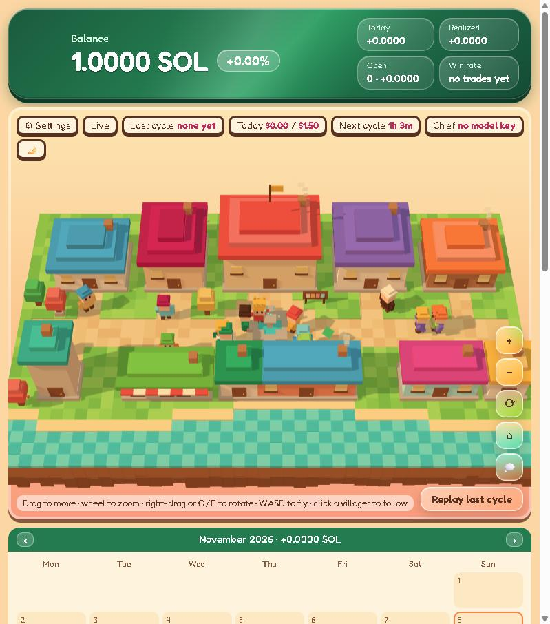
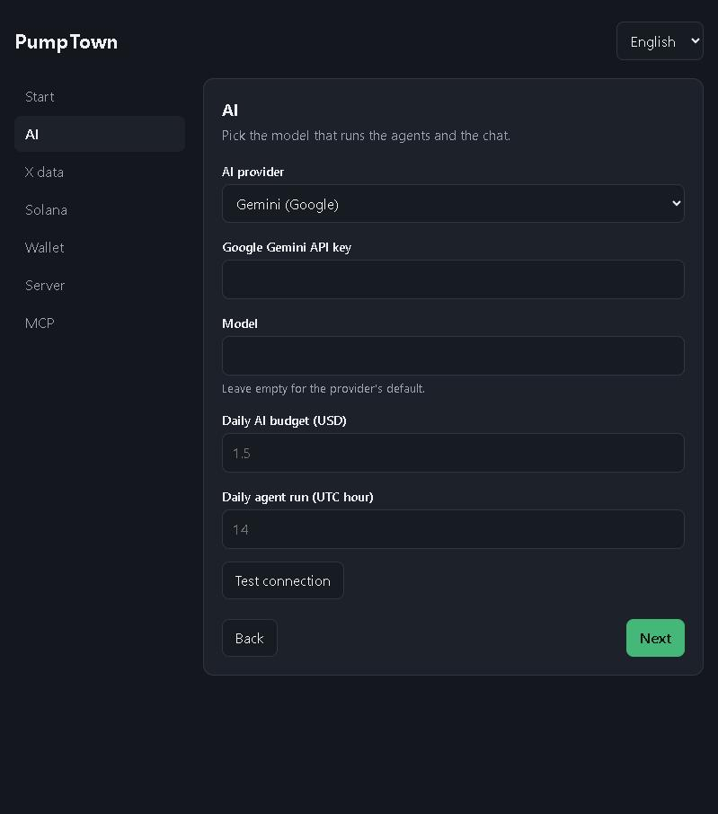
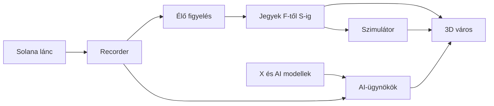

<div align="center">

# PumpTown

**Élő pump.fun kutatólabor, amelyet egy kis AI-város működtet.**

[English](README.md) · **Magyar**

 



</div>

A PumpTown rögzíti a pump.fun kereskedéseket, pontozza az aktív coinokat, és élő árakon teszteli a kereskedési szabályokat. AI-ügynökök trendeket figyelnek és coin-ötleteket javasolnak, mindezt egy 3D városban követheted. A saját gépeden fut, és üresen indul.

A kereskedések szimuláltak. A PumpTown nem küld megbízást, és sosem kér privát kulcsot. Ez nem pénzügyi tanácsadás.

## Gyors indítás

[Python 3.11+](https://www.python.org/downloads/) kell hozzá.

| Rendszer | Indítás |
|---|---|
| Windows | Kattints duplán a `start.bat` fájlra |
| macOS vagy Linux | `./start.sh` |

A böngészőben megnyílik a beállítás. Add meg, amid van, a többit hagyd ki. Később bármikor visszatérhetsz a **⚙ Settings** gombbal.

<div align="center"></div>

## Mit csatlakoztathatsz

| Beállítás | Mit ad | Kell? |
|---|---|---|
| **AI szolgáltató** | Ügynökök és a Chief chat. Claude, ChatGPT, Gemini, Grok, OpenRouter, Groq, Mistral, DeepSeek, Ollama vagy bármilyen OpenAI-kompatibilis API | Az ügynökökhöz és a chathez |
| **X adatok** | Trendfigyelés és coin-ellenőrzés, xAI-kulccsal vagy X API tokennel | Opcionális |
| **Solana RPC** | Top tartók adatai. Egy ingyenes Helius-kulcs is jó | Opcionális |
| **Saját wallet** | Egyenleg, pump.fun profil-link és a kereskedéseid, a nyilvános címed alapján | Opcionális |
| **Követett walletek** | Jelölés azokon a coinokon, amelyeket ezek a walletek vesznek | Opcionális |
| **Szerver** | A PumpTown futtatása a saját VPS-eden, SSH-n át | Opcionális |
| **MCP-szerverek** | Extra eszközök a Chief chathez | Opcionális |

Kulcs nélkül is ingyen fut a recorder, a pontozás és a szimulátor.

A kulcsaid egy helyi `.env` fájlban maradnak. A beállítások oldal le tudja cserélni őket, de többé nem mutatja meg.

## Hogyan működik



A jegyek F-től S-ig tartanak, és a coinról elérhető bizonyítékot értékelik. Az alapértelmezett be- és kiszállási szabályok a [docs/rules.md](docs/rules.md) fájlban vannak (angolul), és módosíthatod őket.

## Mappaszerkezet

```text
PumpTown/
├── start.bat, start.sh   Indítás egy kattintással
├── run.py                Minden szolgáltatást elindít
├── recorder/             A pump.fun és PumpSwap kereskedések rögzítése
├── copilot/              Coin-riportok, AI szolgáltatók, X és MCP kapcsolatok
├── village/              Pontozás, szimulátor, ügynökök, város és beállítások
├── docs/                 Szabályok és képek
└── tests/                Kulcs nélkül futó tesztek
```

## Futtatás szerveren

Töltsd ki a **Settings → Server** részt, majd nyomd meg a **Másolás a szerverre és indítás** gombot. A város megnyitása a saját gépedről:

```bash
python run.py tunnel
```

A recorder naponta kb. 4 GB-ot ír, alapból az utolsó 7 napot tartja meg.

## Tesztek

```bash
python tests/test_app.py
python tests/test_x_check.py
```

## Licenc

[MIT](LICENSE). A szoftver garancia nélkül jár, a használatáért te felelsz.

Első indításkor a PumpTown letölti a pump.fun interfész-fájljait a [pump-public-docs](https://github.com/pump-fun/pump-public-docs) repóból. Ezek nem részei ennek a repónak.
