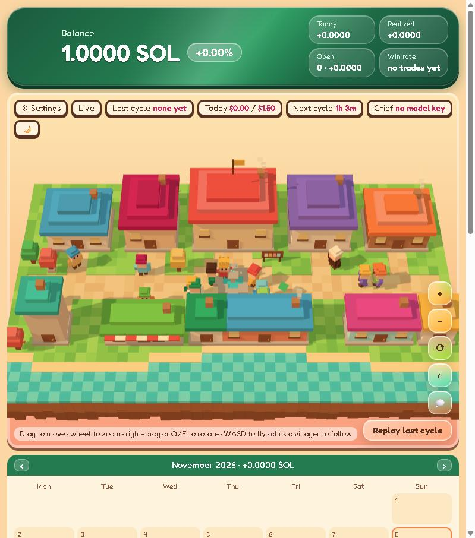
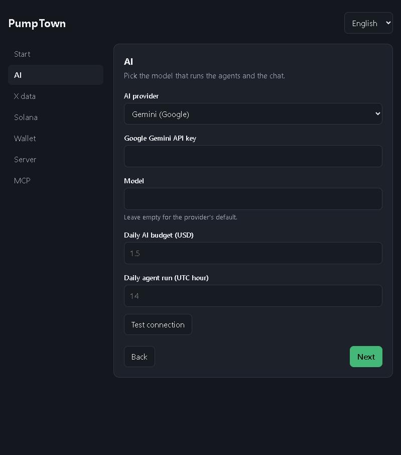
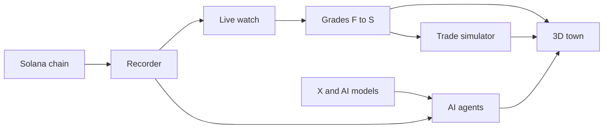

<div align="center">

# PumpTown

**A live pump.fun research lab, run by a small AI town.**

**English** · [Magyar](README.hu.md)

 



</div>

PumpTown records pump.fun trades, grades active coins and tests trading rules on live prices. AI agents scan trends and suggest coin ideas, and you can watch all of it in a 3D town. It runs on your own computer and starts empty.

Trades are simulated. PumpTown sends no orders and never asks for a private key. This is not financial advice.

## Quick start

You need [Python 3.11+](https://www.python.org/downloads/).

| System | Run |
|---|---|
| Windows | Double-click `start.bat` |
| macOS or Linux | `./start.sh` |

The setup page opens in your browser. Add what you have and skip the rest. You can return any time with **⚙ Settings**.

<div align="center"></div>

## What you can connect

| Setting | What it adds | Needed? |
|---|---|---|
| **AI provider** | Agents and the Chief chat. Claude, ChatGPT, Gemini, Grok, OpenRouter, Groq, Mistral, DeepSeek, Ollama, or any OpenAI-compatible API | For the agents and the chat |
| **X data** | Trend scans and coin checks, through an xAI key or an X API token | Optional |
| **Solana RPC** | Top holder data. A free Helius key works | Optional |
| **Your wallet** | Balance, pump.fun profile link and your trades, from your public address | Optional |
| **Tracked wallets** | A tag on coins these wallets buy | Optional |
| **Server** | Run PumpTown on your own VPS over SSH | Optional |
| **MCP servers** | Extra tools for the Chief chat | Optional |

Without any key, the recorder, the grades and the simulator still run for free.

Your keys stay in a local `.env` file. The settings page can replace them but never shows them again.

## How it works



Grades run from F to S and rate the evidence on a coin. The default entry and exit rules are in [docs/rules.md](docs/rules.md), and you can change them.

## Project layout

```text
PumpTown/
├── start.bat, start.sh   One-click start
├── run.py                Starts every service
├── recorder/             Records pump.fun and PumpSwap trades
├── copilot/              Coin reports, AI providers, X and MCP connections
├── village/              Grading, simulator, agents, town and settings page
├── docs/                 Rules and images
└── tests/                Tests that need no keys
```

## Run on a server

Fill in **Settings → Server**, then press **Copy to server and start**. To open the town from your computer:

```bash
python run.py tunnel
```

The recorder writes about 4 GB a day. By default it keeps the last 7 days.

## Tests

```bash
python tests/test_app.py
python tests/test_x_check.py
```

## License

[MIT](LICENSE). The software comes with no warranty, and you are responsible for how you use it.

On first start, PumpTown downloads pump.fun's interface files from [pump-public-docs](https://github.com/pump-fun/pump-public-docs). They are not part of this repository.
